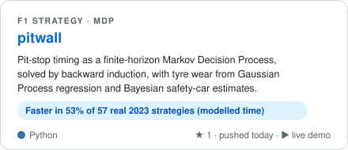
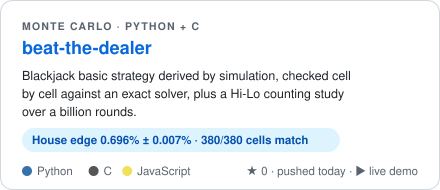
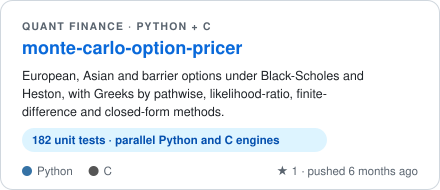
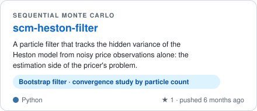
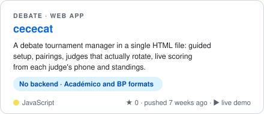
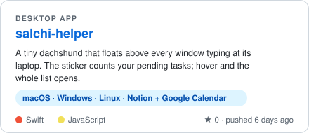
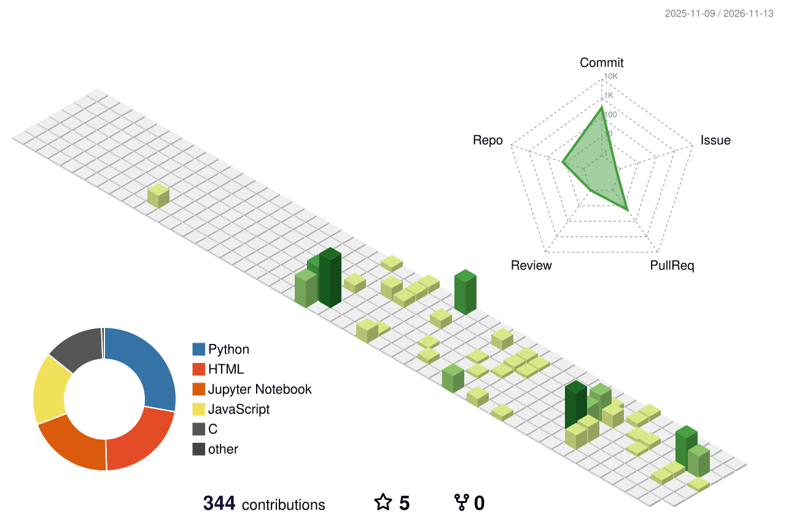

<div align="center">


<br/>

<a href="https://claudialbombin.github.io/"></a>
<a href="https://linkedin.com/in/claudia-lopez-bombin"></a>
<a href="mailto:claudialbombin@gmail.com"></a>
<a href="https://x.com/claudialbzz"></a>
<a href="https://instagram.com/claudialbzz"></a>

<br/><br/>

<a href="#about"><b>About</b></a> ·
<a href="#projects"><b>Projects</b></a> ·
<a href="#more"><b>More</b></a> ·
<a href="#tech-stack"><b>Tech stack</b></a> ·
<a href="#activity"><b>Activity</b></a>

</div>

<br/>

<div id="about"></div>

## 💫 About me

I'm a third-year **Mathematical Engineering & Artificial Intelligence** student at **ICAI, Universidad Pontificia Comillas**, and a **42 Madrid (Fundación Telefónica) Cursus** student on the side. Most of what lives here comes back to one idea: **turning uncertainty into a number I can act on**. That means Monte Carlo option pricing, an F1 pit-stop strategy solved as a Markov Decision Process, particle filters for stochastic volatility and a blackjack solver, alongside ICAI coursework and 42's C curriculum.

I also compete in academic and British Parliamentary debate, which is where the habit of stress-testing an argument before trusting it comes from. I apply the same instinct to a model before trusting its output, and every project below reports its limitations next to its results.

```python
class Claudia:
    studies   = ["iMAT @ ICAI (year 3)", "42 Madrid Cursus"]
    builds    = ["stochastic simulation", "quant models", "small tools I actually use"]
    languages = ["Python", "C", "JavaScript"]
    debates   = "British Parliamentary"
    looking_for = "analytical / quant internships, summer 2027"
```

<div id="projects"></div>

## 🚀 Featured projects

<sub>Cards are regenerated daily from the GitHub API (stars, last push). Click a card to open the live demo, or the repo if there is none.</sub>

<table>
<tr>
<td width="50%" valign="top">
<a href="https://claudialbombin.github.io/pitwall/">
<picture>
  <source media="(prefers-color-scheme: dark)" srcset="assets/generated/cards/pitwall-dark.svg"/>
  
</picture>
</a>
<p align="center"><a href="https://claudialbombin.github.io/pitwall/"><b>▶ Live demo</b></a> · <a href="https://github.com/claudialbombin/pitwall"><b>Code</b></a></p>
<details><summary>How it works</summary>
<ul><li>Tyre degradation per compound fitted with <b>Gaussian Process regression</b> on FastF1 lap data; safety-car probability by Bayesian updating.</li><li>Optimal pit-lap policy from <b>backward induction</b> over the full state space, stress-tested with Monte Carlo race simulations.</li><li>Backtested against real 2023 races. Honest result: a slight edge in head-to-head comparisons, not yet a proven strategy advantage.</li></ul>
</details>
</td>
<td width="50%" valign="top">
<a href="https://claudialbombin.github.io/beat-the-dealer/">
<picture>
  <source media="(prefers-color-scheme: dark)" srcset="assets/generated/cards/beat-the-dealer-dark.svg"/>
  
</picture>
</a>
<p align="center"><a href="https://claudialbombin.github.io/beat-the-dealer/"><b>▶ Live demo</b></a> · <a href="https://github.com/claudialbombin/beat-the-dealer"><b>Code</b></a></p>
<details><summary>How it works</summary>
<ul><li>Basic strategy derived by Monte Carlo (with common random numbers for variance reduction), then checked against an exact solver: <b>380/380</b> decisions agree.</li><li>A C shoe simulator runs the <b>Hi-Lo</b> study: +0.50% player edge per true count.</li><li>The site lets you play with a coach, drill the chart and watch Monte Carlo estimates converge live in a Web Worker.</li></ul>
</details>
</td>
</tr>
<tr>
<td width="50%" valign="top">
<a href="https://github.com/claudialbombin/monte-carlo-option-pricer">
<picture>
  <source media="(prefers-color-scheme: dark)" srcset="assets/generated/cards/monte-carlo-option-pricer-dark.svg"/>
  
</picture>
</a>
<p align="center"><a href="https://github.com/claudialbombin/monte-carlo-option-pricer"><b>Code</b></a></p>
<details><summary>How it works</summary>
<ul><li>Black-Scholes and Heston paths (Euler, with absorption or reflection at zero variance) for European, Asian and barrier payoffs.</li><li>Greeks four ways, showing why pathwise fails on discontinuous payoffs and likelihood-ratio does not.</li><li>Python and C engines side by side, validated against closed-form prices.</li></ul>
</details>
</td>
<td width="50%" valign="top">
<a href="https://github.com/claudialbombin/scm-heston-filter">
<picture>
  <source media="(prefers-color-scheme: dark)" srcset="assets/generated/cards/scm-heston-filter-dark.svg"/>
  
</picture>
</a>
<p align="center"><a href="https://github.com/claudialbombin/scm-heston-filter"><b>Code</b></a></p>
<details><summary>How it works</summary>
<ul><li>Bootstrap particle filter for the latent variance of the Heston model, observed only through noisy prices.</li><li>Convergence study by particle count, plus the implied-volatility smile the Heston model produces.</li></ul>
</details>
</td>
</tr>
<tr>
<td width="50%" valign="top">
<a href="https://claudialbombin.github.io/cececat/">
<picture>
  <source media="(prefers-color-scheme: dark)" srcset="assets/generated/cards/cececat-dark.svg"/>
  
</picture>
</a>
<p align="center"><a href="https://claudialbombin.github.io/cececat/"><b>▶ Live demo</b></a> · <a href="https://github.com/claudialbombin/cececat"><b>Code</b></a></p>
<details><summary>How it works</summary>
<ul><li>Pairings, judge rotation, scoring and standings all run in the browser; state autosaves locally.</li><li>Judges can score from their phones in real time through Firestore; links are sent by email.</li><li>Built for the Académico and British Parliamentary formats I compete in.</li></ul>
</details>
</td>
<td width="50%" valign="top">
<a href="https://github.com/claudialbombin/salchi-helper">
<picture>
  <source media="(prefers-color-scheme: dark)" srcset="assets/generated/cards/salchi-helper-dark.svg"/>
  
</picture>
</a>
<p align="center"><a href="https://github.com/claudialbombin/salchi-helper"><b>Code</b></a></p>
<details><summary>How it works</summary>
<ul><li>Builds for macOS, Windows and Linux, each in two editions (local or Notion) that share all their code.</li><li>Optional Notion back end, so the same list follows you to your phone and an AI assistant can add tasks.</li><li>Dated tasks can sync to Google Calendar and disappear when ticked off.</li></ul>
</details>
</td>
</tr>
</table>

<div id="more"></div>

## 🧩 More I've built

| | Project | What it is |
|---|---|---|
| 🫁 | [**pause**](https://github.com/claudialbombin/pause) · [demo](https://claudialbombin.github.io/pause/) | Installable PWA that puts a short breathing exercise between you and Instagram, TikTok or YouTube: friction, not a hard block. |
| 🍳 | [**recetario-familiar**](https://github.com/claudialbombin/recetario-familiar) · [demo](https://claudialbombin.github.io/recetario-familiar/) | My family's recipe book as a small web app. |
| 🌐 | [**claudialbombin.github.io**](https://github.com/claudialbombin/claudialbombin.github.io) · [site](https://claudialbombin.github.io/) | My portfolio: one page per project with the question, the method and the numbers. |
| 🖥️ | [**42**](https://github.com/claudialbombin/42) | 42 Madrid Piscine and Cursus in C: [Libft](https://github.com/claudialbombin/42/tree/main/Cursus/Rank00/Libft), [ft_printf](https://github.com/claudialbombin/42/tree/main/Cursus/Rank01/ft_printf), [get_next_line](https://github.com/claudialbombin/42/tree/main/Cursus/Rank01/get_next_line), [push_swap](https://github.com/claudialbombin/42/tree/main/Cursus/Rank01/push_swap), [BSQ](https://github.com/claudialbombin/42/tree/main/Piscine/BSQ), [A-maze-ing](https://github.com/claudialbombin/42/tree/main/Cursus/Rank02/A-maze-ing). |
| 🎓 | [**2imat**](https://github.com/claudialbombin/2imat) · [**3imat**](https://github.com/claudialbombin/3imat) | ICAI coursework: data acquisition, ML, SQL/MongoDB/Neo4j, visualisation (year 2); year 3 just started. |
| 🀄 | [**mus-stochastic-suite**](https://github.com/claudialbombin/mus-stochastic-suite) <sub>planned</sub> | A Mus engine with bots and Monte Carlo strategy analysis. Design stage, no code yet. |

<div id="tech-stack"></div>

## 💻 Tech stack

<sub>Each badge links to a repo where that tool is actually used.</sub>

<p><sub><b>Languages</b></sub></p>
<a href="https://github.com/claudialbombin/pitwall"></a>
<a href="https://github.com/claudialbombin/beat-the-dealer"></a>
<a href="https://github.com/claudialbombin/beat-the-dealer"></a>

<p><sub><b>Data science & ML</b></sub></p>
<a href="https://github.com/claudialbombin/pitwall"></a>
<a href="https://github.com/claudialbombin/pitwall"></a>
<a href="https://github.com/claudialbombin/scm-heston-filter"></a>
<a href="https://github.com/claudialbombin/2imat"></a>
<a href="https://github.com/claudialbombin/2imat"></a>
<a href="https://github.com/claudialbombin/monte-carlo-option-pricer"></a>

<p><sub><b>Databases</b></sub></p>
<a href="https://github.com/claudialbombin/2imat"></a>
<a href="https://github.com/claudialbombin/2imat"></a>
<a href="https://github.com/claudialbombin/2imat"></a>

<p><sub><b>Dashboards & viz</b></sub></p>
<a href="https://github.com/claudialbombin/2imat"></a>
<a href="https://github.com/claudialbombin/2imat"></a>

<p><sub><b>Web</b></sub></p>
<a href="https://github.com/claudialbombin/cececat"></a>
<a href="https://github.com/claudialbombin/beat-the-dealer"></a>

<p><sub><b>Testing & CI/CD</b></sub></p>
<a href="https://github.com/claudialbombin/monte-carlo-option-pricer"></a>
<a href="./.github/workflows/refresh-profile.yml"></a>

<div id="activity"></div>

## 📊 Activity

<div align="center">

<picture>
  <source media="(prefers-color-scheme: dark)" srcset="assets/generated/activity-dark.svg"/>
  
</picture>

<br/><br/>

<picture>
  <source media="(prefers-color-scheme: dark)" srcset="assets/generated/stats-dark.svg"/>
  
</picture>

<br/><br/>

<picture>
  <source media="(prefers-color-scheme: dark)" srcset="assets/generated/langs-dark.svg"/>
  
</picture>

<br/><br/>

<picture>
  <source media="(prefers-color-scheme: dark)" srcset="profile-3d-contrib/profile-night-green.svg"/>
  
</picture>

</div>

<sub>Language shares exclude Jupyter notebooks (their bytes are mostly outputs) and two repos whose bundled files distort the count; the reasons are listed in <a href="scripts/featured.json"><code>featured.json</code></a>.</sub>

<details>
<summary><b>🐍 Watch a snake eat my contribution graph</b></summary>
<br/>
<picture>
  <source media="(prefers-color-scheme: dark)" srcset="https://raw.githubusercontent.com/claudialbombin/claudialbombin/output/github-contribution-grid-snake-dark.svg"/>
  
</picture>
</details>

---

<div align="center">
<sub>This profile rebuilds itself every morning: <a href="scripts/generate_stats.py"><code>generate_stats.py</code></a> reads <a href="scripts/featured.json"><code>featured.json</code></a> and the GitHub API, and <a href="./.github/workflows/refresh-profile.yml">a GitHub Action</a> commits the new SVGs. No third-party badge services.</sub>
</div>
